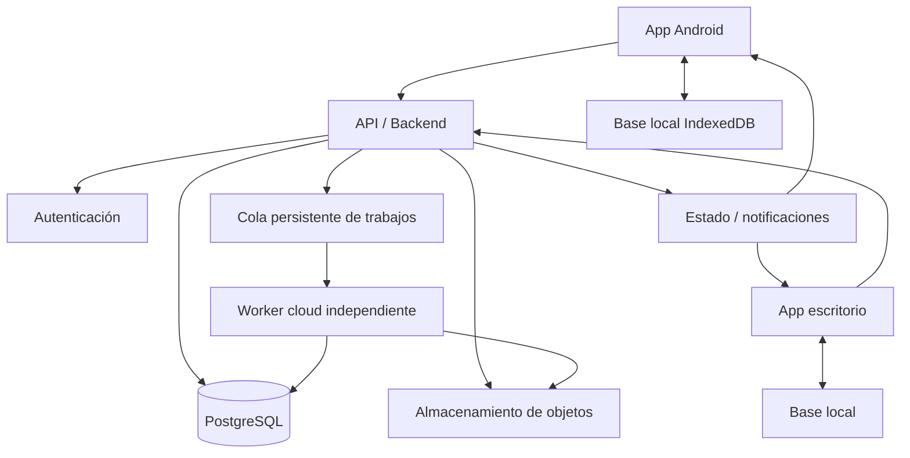

# Fase 6 — Investigación de arquitectura Cloud-First

## 1. Objetivo

Diseñar una arquitectura en la que el teléfono y la computadora sean clientes de control y edición, mientras que los datos compartidos y los trabajos remotos residan en servicios cloud persistentes.

La aplicación debe seguir siendo útil cuando no haya conexión y no debe depender de que el teléfono permanezca encendido para completar trabajos remotos.

## 2. Principios

- **Cloud-first, no cloud-only:** el cliente conserva capacidades locales y modo offline.
- **Persistencia real:** los proyectos sincronizados deben sobrevivir al cierre de sesión y al cambio de dispositivo.
- **Ejecución desacoplada:** una solicitud crea un trabajo persistente; un worker independiente lo procesa.
- **Fuente de verdad definida:** cada dato debe tener autoridad local o remota claramente establecida.
- **Seguridad por defecto:** autenticación real, permisos mínimos, archivos privados y secretos solo en servidor.
- **Coste controlado:** no mantener workers activos sin necesidad; límites de uso y cuotas.
- **Migración reversible:** no borrar IndexedDB al activar cloud.

## 3. Arquitectura lógica propuesta

El diagrama representa el objetivo, no el estado actualmente desplegado.

## 4. Componentes recomendados

### 4.1 Cliente instalado

React/Vite puede seguir siendo la base de interfaz mientras las pruebas confirmen compatibilidad. Capacitor puede servir como contenedor Android. La aplicación de escritorio requiere una decisión separada (por ejemplo, Tauri o cliente web empaquetado), basada en pruebas y mantenimiento.

Responsabilidades:
- interfaz y edición;
- caché local;
- captura de cambios;
- cola offline local;
- carga y descarga de medios;
- supervisión y aprobación de trabajos;
- notificaciones cuando el sistema operativo y el despliegue lo permitan.

No debe contener claves administrativas ni ejecutar renders prolongados como única vía de procesamiento.

### 4.2 Backend y API

Responsabilidades:
- validar sesiones y permisos;
- validar propiedad de proyectos;
- aceptar cambios;
- crear trabajos;
- emitir URLs firmadas de corta duración;
- consultar estado de trabajos;
- aplicar límites y cuotas;
- auditar acciones relevantes.

No exponer claves `service_role`, credenciales de base de datos ni secretos de workers en el frontend.

### 4.3 Autenticación

Un proveedor como Supabase Auth puede reducir trabajo inicial. Alternativamente, un backend propio puede gestionar identidad y sesiones. Comparar recuperación de cuenta, seguridad, límites gratuitos, dependencia del proveedor y facilidad de mantenimiento.

Mínimos:
- registro e inicio de sesión por correo;
- recuperación de acceso;
- sesiones revocables;
- separación de datos por usuario;
- protección frente a enumeración de cuentas y abuso;
- política clara de eliminación/exportación.

### 4.4 PostgreSQL

Entidades conceptuales:
- `profiles`
- `projects`
- `project_versions`
- `assets`
- `jobs`
- `job_events`
- `sync_operations`
- `usage_quotas`

Cada tabla con `user_id`/propietario cuando corresponda. Las políticas RLS deben probarse con usuarios distintos y consultas negativas; no basta con que el SQL contenga una declaración RLS.

### 4.5 Almacenamiento de objetos

Los archivos grandes no deben almacenarse como blobs dentro de filas PostgreSQL. Usar almacenamiento de objetos privado, metadatos en base de datos y URLs firmadas con caducidad.

Requisitos:
- límites de tamaño y tipo MIME;
- checksum;
- cargas multipart/resumibles cuando estén disponibles;
- política de retención;
- limpieza de cargas incompletas;
- control de descargas y transferencia.

### 4.6 Cola y workers

El backend registra un trabajo duradero y lo coloca en una cola. Un worker independiente lo reclama mediante lease/lock, registra heartbeat, procesa, sube el resultado y actualiza el estado.

Estados propuestos:
`queued → validating → running → uploading → succeeded`
y estados terminales alternativos: `failed`, `cancelled`, `expired`.

Usar idempotency key para evitar trabajos duplicados. Definir reintentos limitados y distinguir errores transitorios de errores permanentes.

## 5. Comparación de opciones

| Opción | Ventajas | Límites / riesgos | Papel posible |
|---|---|---|---|
| Supabase | Auth, PostgreSQL, Storage, RLS integrados | Cuotas, límites de almacenamiento/egress, funciones no equivalentes a workers de render prolongado | Backend inicial candidato |
| Backend propio | Control y portabilidad | Mayor desarrollo, operación y seguridad | Alternativa si crece la complejidad |
| Worker en contenedor bajo demanda | Adecuado para FFmpeg y tareas largas | Arranque, cuota de CPU/RAM, almacenamiento temporal y coste | Render remoto |
| Funciones serverless | Buenas para API y tareas cortas | Límites de duración/CPU y memoria | Validaciones y coordinación |
| Cola gestionada | Durabilidad y reintentos | Coste o límites del proveedor | Orquestación de jobs |

## 6. Diseño de seguridad

- RLS para cada tabla accesible desde cliente.
- Storage privado por defecto.
- URLs firmadas de alcance y duración limitados.
- Validación server-side de cada job y archivo.
- Límites por usuario, tamaño, concurrencia y duración.
- Secretos solo en variables del servidor/secret manager.
- Logs sin tokens, contraseñas ni URLs sensibles.
- Backups separados del entorno primario.
- Pruebas de acceso cruzado entre cuentas.
- Política de eliminación y retención.

## 7. Arquitectura por etapas

**Etapa A — sin coste:** mantener local-first; definir contratos de datos, esquema y pruebas; crear prototipo local de API si hace falta.

**Etapa B — cloud básico:** autenticación y base de datos en un plan gratuito, solo después de verificar cuotas y condiciones vigentes. No activar cargas grandes automáticamente.

**Etapa C — sync:** replicación controlada de metadatos y proyectos pequeños; medios mediante almacenamiento privado.

**Etapa D — jobs:** cola persistente y worker bajo demanda. No confundir una Edge Function con un renderizador de varios minutos sin verificar límites.

**Etapa E — render:** habilitar solo cuando exista presupuesto autorizado o un worker gratuito con límites adecuados y pruebas de calidad.

## 8. Coste objetivo US$0/mes

Es posible mantener la fase de investigación, desarrollo local y pruebas manuales en cero dólares mensuales. También puede ser posible una demostración limitada utilizando tiers gratuitos, pero no se debe prometer disponibilidad, almacenamiento o render ilimitado.

Costes que deben vigilarse:
- base de datos y almacenamiento;
- transferencia/egress;
- cómputo de workers;
- tiempo de render;
- logs y backups;
- dominios y distribución;
- notificaciones.

**Regla de presupuesto:** no activar un servicio si no se conocen su cuota, límite de suspensión, política de inactividad, coste por exceso y procedimiento para desactivar facturación.

## 9. Decisión provisional

Arquitectura candidata: cliente React existente + Capacitor Android + PostgreSQL/Auth/Storage gestionados si sus cuotas gratuitas actuales son suficientes + cola duradera + worker de contenedor bajo demanda.

No se recomienda desplegar aún. Antes se debe validar precio y límites vigentes, definir un presupuesto duro, comprobar RLS y realizar una prueba pequeña con datos ficticios.

## 10. Criterios de aceptación

- Diagrama de componentes y flujo de datos.
- Contratos API y estados de job definidos.
- Modelo de seguridad y aislamiento.
- Costes y límites documentados con fecha y fuente.
- Sin dependencia del teléfono para trabajos remotos.
- Sin credenciales secretas en el cliente.
