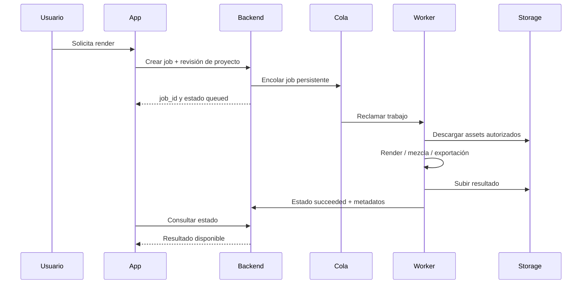

# Fase 6 — Arquitectura de procesamiento audiovisual remoto

## 1. Objetivo

Diseñar la evolución del motor audiovisual para permitir trabajos remotos persistentes, mejorar la calidad de producción y conservar el motor local actual como respaldo mientras las alternativas no demuestren una ventaja.

## 2. Estado de partida

Según los informes compartidos, el proyecto utiliza Canvas 2D, Web Audio API y MediaRecorder para previsualización y exportación local. Se reportó WebM 720p/30fps. La salida MP4 depende del soporte del navegador y no debe prometerse universalmente.

Los informes también señalaron que Web Speech API no garantiza que la voz sintetizada quede incorporada a la pista exportada. Se deben usar archivos de audio explícitos o una ruta de audio verificable.

## 3. Opciones tecnológicas

| Tecnología | Fortaleza | Consideración |
|---|---|---|
| Canvas 2D actual | Ligero y ya integrado | Mantener para motion graphics 2D y fallback |
| Web Audio API | Mezcla y procesamiento en cliente | Límites del dispositivo y captura de audio |
| MediaRecorder | Exportación local nativa | Códecs dependen del navegador |
| FFmpeg | Transcodificación, mezcla y muxing robustos | Requiere CPU/RAM y entorno de ejecución |
| FFmpeg.wasm | Procesamiento local en navegador | Alto uso de memoria/CPU, especialmente móvil |
| Motion Canvas | Animación programática con código | Evaluar curva de aprendizaje y flujo de exportación |
| Remotion | Composición de video con React | Revisar licencia, infraestructura y coste |
| Blender | Escenas 3D y composición avanzada | Mayor complejidad y consumo de recursos |

No integrar todas las herramientas. Seleccionar por caso de uso, licencia, rendimiento y calidad demostrada.

## 4. Flujo remoto propuesto

El worker debe ejecutarse independientemente de la app. El job debe apuntar a una revisión inmutable del proyecto para evitar que el resultado mezcle versiones.

## 5. Contrato de job

Campos mínimos:
- `job_id`
- `owner_id`
- `project_id`
- `project_revision`
- `job_type`
- `parameters`
- `status`
- `progress`
- `created_at`, `started_at`, `finished_at`
- `attempt`
- `idempotency_key`
- `input_manifest`
- `output_asset_id`
- `error_code`, `error_message_safe`

Los logs técnicos no deben exponer secretos ni datos personales innecesarios.

## 6. Fiabilidad

- Cola persistente.
- Worker con lease/heartbeat.
- Reintentos limitados.
- Idempotencia.
- Cancelación cooperativa.
- Límite de CPU, RAM, tiempo y tamaño de archivo.
- Almacenamiento temporal con limpieza.
- Checksum de entrada/salida.
- Versionado de motor y preset.
- Resultado reproducible asociado a la revisión exacta.

## 7. Calidad audiovisual

Definir presets medibles:
- resolución;
- FPS;
- bitrate;
- códec;
- audio sample rate/codec;
- loudness objetivo;
- subtítulos;
- relación de aspecto;
- calidad de imagen y texto.

Pruebas obligatorias:
- texto legible en móvil;
- sincronía de voz y subtítulos;
- pista de audio incorporada;
- ausencia de frames negros o perdidos;
- reproducción en reproductores comunes;
- tamaño y bitrate coherentes;
- render reproducible.

La calidad no se mide solo por resolución: composición, ritmo, continuidad visual, imágenes con licencia, audio y diseño narrativo son igualmente importantes.

## 8. Coste US$0/mes

Render remoto sostenido normalmente consume cómputo y almacenamiento. No es responsable prometer renders ilimitados a coste cero.

Plan sin gasto:
- conservar render local actual;
- probar FFmpeg y herramientas en entorno local/de desarrollo disponible;
- usar videos de prueba cortos y assets pequeños;
- diseñar worker y cola sin desplegar;
- medir CPU, RAM y tiempo;
- no ejecutar workers 24/7;
- no activar servicios con facturación sin autorización.

Una demo gratuita podría ser viable con límites de duración, resolución, número de trabajos y cuota mensual, según el proveedor y sus términos vigentes.

## 9. Ruta recomendada

1. Verificar el motor Canvas actual y su salida.
2. Corregir la captura de audio con un test reproducible.
3. Crear un manifiesto de proyecto exportable.
4. Comparar una escena representativa en Canvas, Motion Canvas/Remotion y FFmpeg.
5. Diseñar job API y worker en prototipo aislado.
6. Evaluar coste por minuto renderizado.
7. Solo entonces seleccionar motor remoto.

## 10. Criterios de aceptación

- El render remoto continúa tras cerrar el cliente.
- El job registra progreso y estado durable.
- El resultado queda asociado a la revisión exacta.
- Audio y video se verifican reproduciéndolos.
- No se altera el motor actual hasta demostrar calidad, coste y fiabilidad superiores.
